# Previsao de Vendas - Online Retail II

## Integrantes

Vitoria Lemes

Ramon Franco

## Introducao

Este projeto aplica o processo CRISP-DM para analisar e prever vendas de uma empresa de varejo online usando o dataset Online Retail II armazenado localmente na pasta `data`. O arquivo identificado foi `online_retail_II.xlsx`, com as abas `Year 2009-2010` e `Year 2010-2011`, consolidadas em uma unica base analitica.

## Objetivo

O objetivo de negocio e apoiar decisoes de planejamento comercial, estoque e acompanhamento de receita por meio da previsao do faturamento diario. A variavel-alvo escolhida foi `daily_revenue`, criada pela agregacao diaria de `Quantity x Price`.

Perguntas orientadoras:

- Quais produtos, paises e clientes concentram maior faturamento?
- Como o faturamento varia ao longo do tempo, por mes e por dia da semana?
- Existem registros inconsistentes que podem distorcer a analise?
- Quais atributos ajudam a prever o faturamento diario?
- Qual modelo de regressao apresenta melhor desempenho para a previsao?

## Descricao da Base de Dados

A base consolidada iniciou com **1,067,371 linhas** e **10 colunas**. Apos a limpeza, restaram **1,029,609 linhas**. O periodo analisado vai de **2009-12-01 07:45:00** a **2011-12-09 12:50:00**.

Resumo apos limpeza:

- Faturamento total: **R$ 20.913.891,47**
- Quantidade total vendida: **11,385,368 unidades**
- Clientes unicos: **5,878**
- Produtos unicos: **4,916**
- Paises unicos: **43**
- Duplicados identificados inicialmente: **12,133**

Arquivos e abas carregados:

| arquivo               | aba            |   linhas |   colunas |
|:----------------------|:---------------|---------:|----------:|
| online_retail_II.xlsx | Year 2009-2010 |   525461 |         8 |
| online_retail_II.xlsx | Year 2010-2011 |   541910 |         8 |

Tipos de dados identificados:

| coluna       | tipo           |
|:-------------|:---------------|
| Invoice      | object         |
| StockCode    | object         |
| Description  | object         |
| Quantity     | int64          |
| InvoiceDate  | datetime64[ns] |
| Price        | float64        |
| CustomerID   | float64        |
| Country      | object         |
| source_file  | object         |
| source_sheet | object         |

Valores nulos:

| coluna       |   nulos |   percentual |
|:-------------|--------:|-------------:|
| Invoice      |       0 |         0    |
| StockCode    |       0 |         0    |
| Description  |    4382 |         0.41 |
| Quantity     |       0 |         0    |
| InvoiceDate  |       0 |         0    |
| Price        |       0 |         0    |
| CustomerID   |  243007 |        22.77 |
| Country      |       0 |         0    |
| source_file  |       0 |         0    |
| source_sheet |       0 |         0    |

## Metodologia CRISP-DM

### 1. Entendimento do Problema

O problema de negocio consiste em entender o comportamento historico das vendas e construir um modelo capaz de estimar faturamento futuro em nivel diario. Essa previsao pode orientar compras, reposicao de estoque, metas comerciais e alocacao operacional em periodos de maior demanda.

### 2. Entendimento dos Dados

Foram avaliadas dimensoes, tipos, valores nulos, duplicados, estatisticas descritivas e amostras. As tabelas completas foram salvas em `outputs/tipos_dados.csv`, `outputs/valores_nulos.csv`, `outputs/estatisticas_descritivas.csv` e `outputs/amostra_dados.csv`.

### 3. Preparacao dos Dados

As principais decisoes de limpeza foram:

| etapa                                        |   removidos |   restantes | justificativa                                                                                |
|:---------------------------------------------|------------:|------------:|:---------------------------------------------------------------------------------------------|
| Conversao de datas e padronizacao textual    |           0 |     1067371 | Garante tipos consistentes para filtros, agregacoes temporais e analises por categorias.     |
| Remocao de duplicados                        |       12133 |     1055238 | Registros repetidos superestimam quantidades e faturamento.                                  |
| Remocao de nulos criticos                    |           0 |     1055238 | Sem invoice, produto, data, quantidade ou preco nao e possivel calcular uma venda confiavel. |
| Remocao de devolucoes/cancelamentos          |       19433 |     1035805 | Invoices iniciadas por C representam cancelamentos e nao devem compor a demanda vendida.     |
| Remocao de quantidades negativas ou zero     |        3457 |     1032348 | Quantidade menor ou igual a zero indica ajuste, erro ou devolucao, nao uma venda positiva.   |
| Remocao de precos negativos ou iguais a zero |        2739 |     1029609 | Preco nao positivo inviabiliza o calculo de faturamento real.                                |
| Remocao de descricoes ausentes               |           0 |     1029609 | Descricoes ausentes dificultam analises de produtos mais vendidos e rentaveis.               |

Os outliers de valor por item foram analisados com a regra do IQR. Foram encontrados **86,701** itens acima de **R$ 38,06**. Eles foram mantidos na base principal porque pedidos grandes podem representar compras atacadistas reais; a decisao foi visualizar seu efeito em histogramas e boxplots com limite no percentil 99 para nao esconder o padrao central.

### 4. Analise Exploratoria

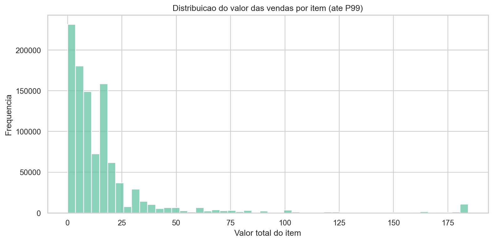

A distribuicao do valor por item e assimetrica: muitos itens possuem baixo valor individual e poucos registros concentram valores altos. Isso e comum em varejo e reforca a necessidade de metricas robustas e modelos capazes de lidar com nao linearidade.

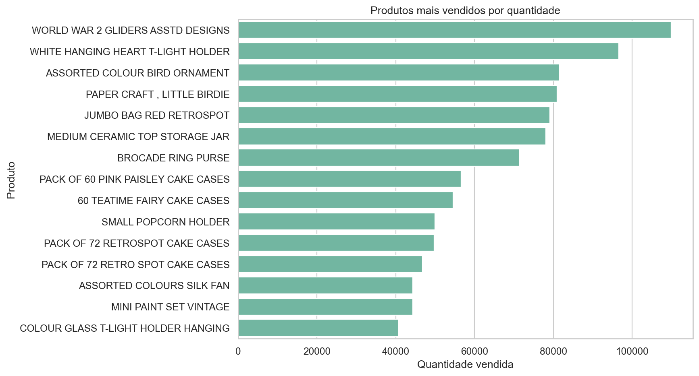

Produtos mais vendidos por quantidade:

| Description                        |   Quantity |
|:-----------------------------------|-----------:|
| WORLD WAR 2 GLIDERS ASSTD DESIGNS  |     109898 |
| WHITE HANGING HEART T-LIGHT HOLDER |      96563 |
| ASSORTED COLOUR BIRD ORNAMENT      |      81590 |
| PAPER CRAFT , LITTLE BIRDIE        |      80995 |
| JUMBO BAG RED RETROSPOT            |      79117 |
| MEDIUM CERAMIC TOP STORAGE JAR     |      78033 |
| BROCADE RING PURSE                 |      71394 |
| PACK OF 60 PINK PAISLEY CAKE CASES |      56625 |

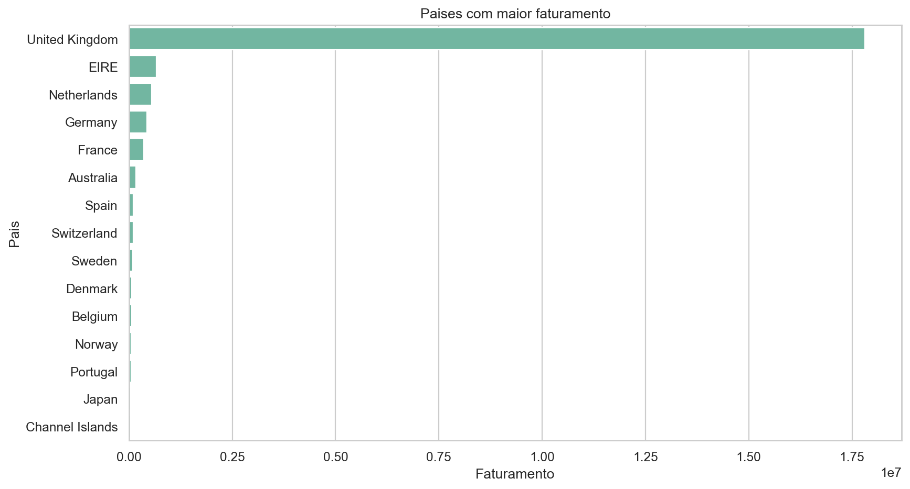

Paises com maior faturamento:

| Country        | TotalSale        |
|:---------------|:-----------------|
| United Kingdom | R$ 17.814.055,93 |
| EIRE           | R$ 664.050,09    |
| Netherlands    | R$ 554.230,69    |
| Germany        | R$ 430.703,79    |
| France         | R$ 356.746,51    |
| Australia      | R$ 169.900,61    |
| Spain          | R$ 109.127,21    |
| Switzerland    | R$ 100.988,99    |

O faturamento tende a ser concentrado no Reino Unido, caracteristica esperada para a base Online Retail II. Isso indica que analises globais podem refletir principalmente o comportamento desse mercado.

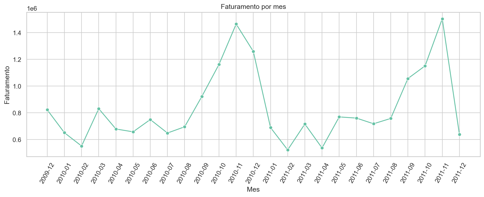

O grafico mensal mostra sazonalidade e variacao temporal. Meses proximos ao fim do ano tendem a ser relevantes em varejo por compras sazonais, o que justifica a criacao de variaveis de mes, semana e defasagens.

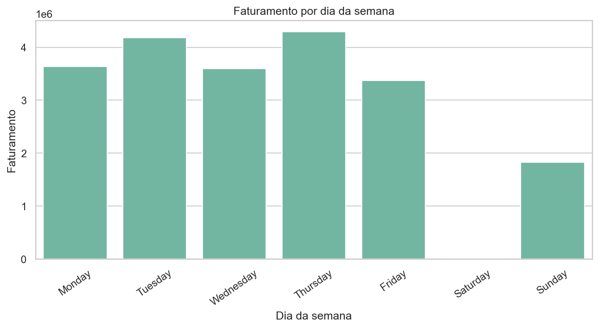

A analise por dia da semana ajuda a identificar padroes operacionais e possiveis dias de menor atividade. Essa informacao foi incorporada na modelagem por `day_of_week` e `is_weekend`.

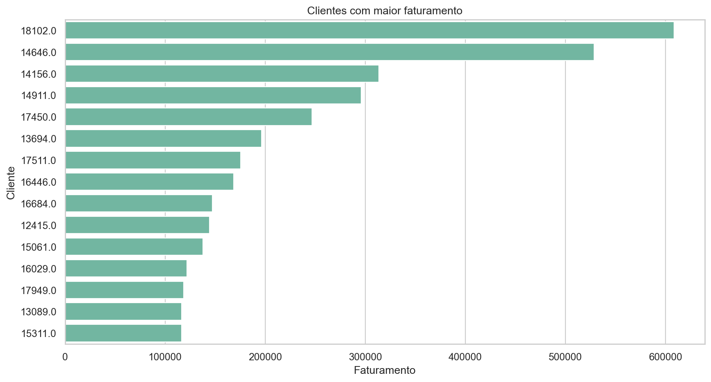

Clientes com maior faturamento:

|   CustomerID | total_revenue   |   invoices |   distinct_products |
|-------------:|:----------------|-----------:|--------------------:|
|        18102 | R$ 608.821,65   |        145 |                 382 |
|        14646 | R$ 528.602,52   |        151 |                 961 |
|        14156 | R$ 313.759,82   |        156 |                1446 |
|        14911 | R$ 295.832,39   |        398 |                2550 |
|        17450 | R$ 246.813,09   |         51 |                 144 |
|        13694 | R$ 196.482,81   |        143 |                 896 |
|        17511 | R$ 175.603,55   |         60 |                 657 |
|        16446 | R$ 168.472,50   |          2 |                   3 |

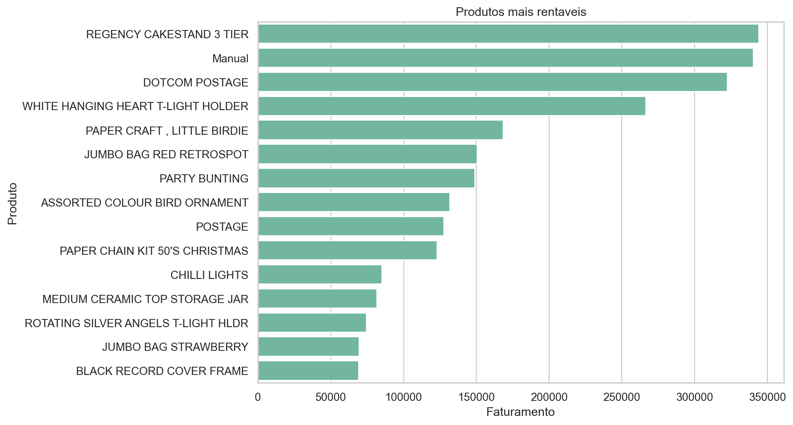

Produtos mais rentaveis:

| Description                        | revenue       |   quantity |
|:-----------------------------------|:--------------|-----------:|
| REGENCY CAKESTAND 3 TIER           | R$ 344.069,30 |      27536 |
| Manual                             | R$ 340.342,68 |       9753 |
| DOTCOM POSTAGE                     | R$ 322.657,48 |       1436 |
| WHITE HANGING HEART T-LIGHT HOLDER | R$ 266.582,35 |      96563 |
| PAPER CRAFT , LITTLE BIRDIE        | R$ 168.469,60 |      80995 |
| JUMBO BAG RED RETROSPOT            | R$ 150.640,27 |      79117 |
| PARTY BUNTING                      | R$ 149.109,35 |      28362 |
| ASSORTED COLOUR BIRD ORNAMENT      | R$ 131.817,81 |      81590 |

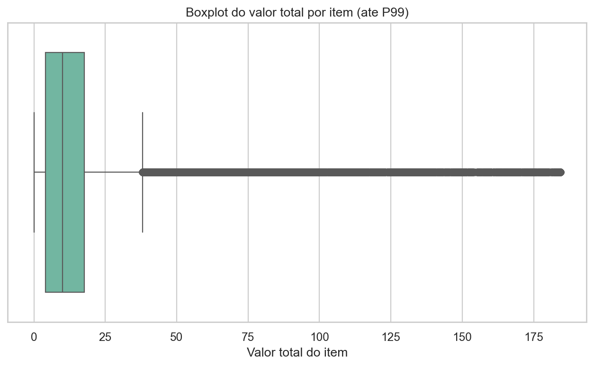

O boxplot evidencia a presenca de vendas por item acima do comportamento central. Elas foram analisadas, mas nao removidas automaticamente para preservar pedidos grandes potencialmente legitimos.

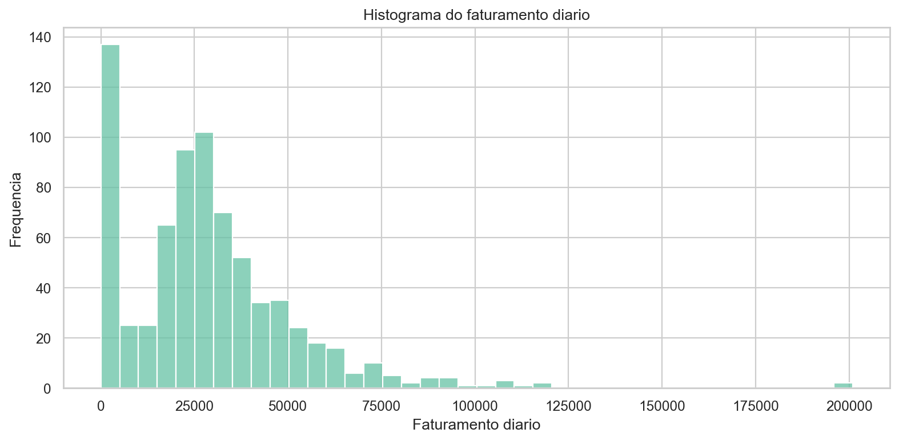

O faturamento diario tambem apresenta dispersao, com dias de movimento baixo e dias de receita elevada. Esse comportamento torna a comparacao de modelos necessaria.

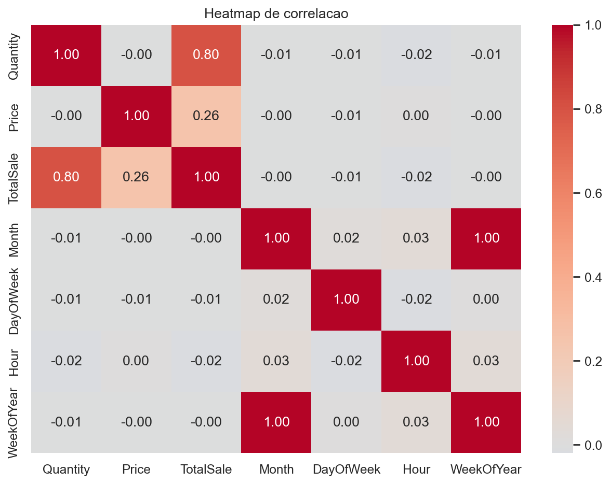

O heatmap mostra relacoes lineares entre quantidade, preco, valor total e variaveis temporais. Correlacoes baixas nao descartam utilidade preditiva, pois modelos de arvore capturam padroes nao lineares.

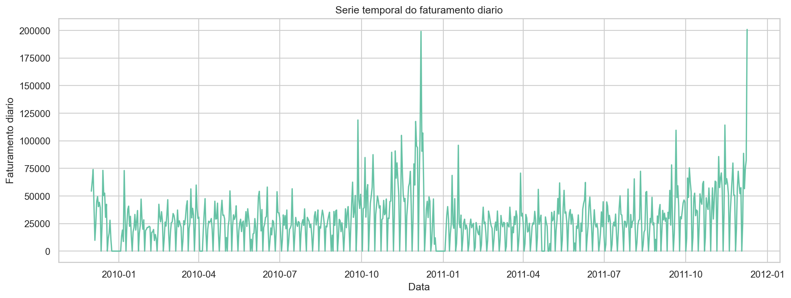

A serie temporal mostra tendencia, sazonalidade e variabilidade diaria. Por isso, a divisao treino/teste foi temporal, preservando a ordem cronologica.

## Engenharia de Atributos

Foram criados os seguintes atributos:

- `TotalSale`: valor total do item, calculado por `Quantity x Price`.
- `Year`, `Month`, `Day`, `DayOfWeek`, `Hour`, `WeekOfYear`: capturam sazonalidade e ciclos de compra.
- `YearMonth`: facilita agregacoes mensais e analises temporais.
- Agregacoes por cliente: faturamento, quantidade, numero de invoices, diversidade de produtos, ticket medio e tempo de relacionamento.
- Agregacao diaria: faturamento, quantidade, invoices, clientes, produtos e preco medio por dia.
- Defasagens (`revenue_lag_1`, `revenue_lag_7`, `revenue_lag_14`, `revenue_lag_28`) e medias/desvios moveis: incorporam memoria temporal e sazonalidade semanal/mensal.

Essas variaveis melhoram a previsao porque transformam transacoes individuais em sinais temporais alinhados ao objetivo de estimar faturamento diario.

## Modelagem

Foram comparados modelos de regressao para valor continuo:

- Linear Regression
- Decision Tree Regressor
- Random Forest Regressor
- Gradient Boosting Regressor
- XGBoost Regressor

A base de modelagem possui **711 dias** apos a criacao das defasagens. A divisao foi temporal: **568 dias** para treino e **143 dias** para teste. A validacao cruzada usou `TimeSeriesSplit`, apropriado para dados temporais porque evita treinar com informacoes posteriores ao periodo validado.

## Resultados

Comparacao dos modelos:

| modelo                      | MAE      | MSE            | RMSE      |     R2 | CV_RMSE   | melhores_parametros                                                               |
|:----------------------------|:---------|:---------------|:----------|-------:|:----------|:----------------------------------------------------------------------------------|
| Gradient Boosting Regressor | 5,251.23 | 102,505,677.83 | 10,124.51 | 0.8687 | 7,942.51  | {"model__learning_rate": 0.05, "model__max_depth": 3, "model__n_estimators": 200} |
| Random Forest Regressor     | 5,264.93 | 121,775,461.91 | 11,035.19 | 0.8441 | 8,379.11  | {"model__max_depth": null, "model__min_samples_leaf": 3}                          |
| XGBoost Regressor           | 6,123.51 | 128,205,757.42 | 11,322.80 | 0.8358 | 7,826.14  | {"model__learning_rate": 0.08, "model__max_depth": 3, "model__subsample": 0.8}    |
| Linear Regression           | 7,634.91 | 159,223,523.14 | 12,618.38 | 0.7961 | 10,954.43 | {}                                                                                |
| Decision Tree Regressor     | 7,929.99 | 223,270,977.78 | 14,942.25 | 0.7141 | 9,465.20  | {"model__max_depth": null, "model__min_samples_leaf": 10}                         |

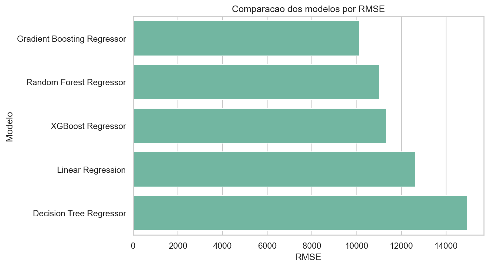

O melhor modelo pelo menor RMSE no conjunto de teste foi **Gradient Boosting Regressor**. A escolha pelo RMSE prioriza modelos que reduzem erros grandes, importantes em previsao de faturamento porque grandes desvios podem afetar planejamento de estoque e metas.

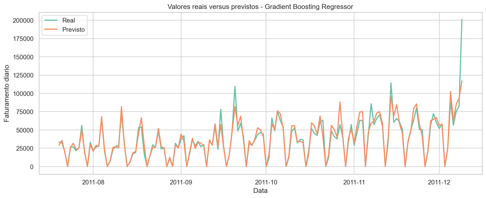

O grafico de valores reais versus previstos permite avaliar visualmente se o modelo acompanha a direcao da serie e se falha em picos especificos.

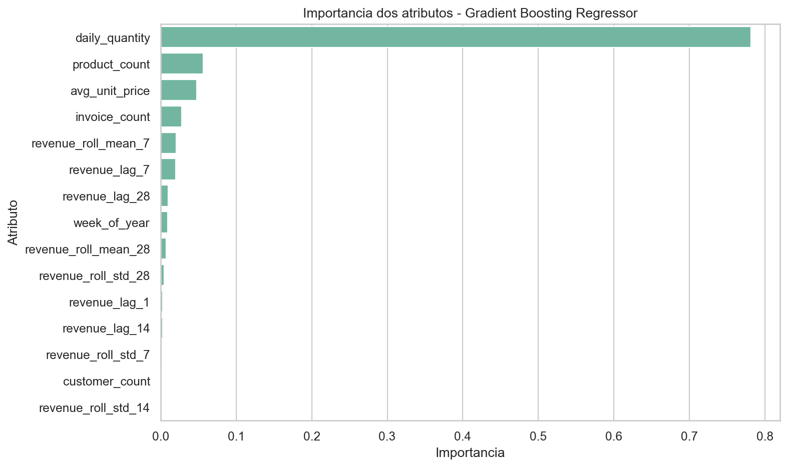

Os atributos mais importantes indicam quais sinais historicos e operacionais mais contribuiram para a previsao. Em modelos de arvore, defasagens e agregacoes recentes costumam ser relevantes porque capturam continuidade temporal.

## Conclusao

O projeto consolidou as duas abas do Online Retail II, removeu registros inconsistentes, criou variaveis temporais e agregacoes de negocio, realizou EDA com graficos interpretaveis e comparou modelos de regressao para prever faturamento diario.

Principais descobertas:

- O faturamento e concentrado em poucos paises, produtos e clientes.
- A distribuicao de vendas e assimetrica, com muitos itens de baixo valor e poucos itens de valor elevado.
- Variaveis temporais e defasagens sao importantes para representar padroes de venda.
- A avaliacao temporal e mais adequada que uma divisao aleatoria para esse problema.

Melhor modelo: **Gradient Boosting Regressor**

- MAE: **5,251.23**
- RMSE: **10,124.51**
- R2: **0.8687**

Limitacoes:

- O dataset contem apenas historico transacional; nao ha informacoes externas como campanhas, feriados, trafego do site ou ruptura de estoque.
- A previsao diaria usa agregacoes historicas, portanto nao explica integralmente eventos comerciais pontuais.
- Pedidos muito grandes foram mantidos por poderem ser reais, mas eles aumentam a dificuldade de prever picos.

Melhorias futuras:

- Incluir calendario de feriados e eventos promocionais.
- Testar modelos especificos de series temporais, como SARIMAX, Prophet ou LightGBM com features temporais.
- Criar previsoes por pais, categoria ou produto para apoiar decisoes mais granulares.
- Avaliar estrategias de tratamento de outliers por segmento, em vez de uma regra global.

## Artefatos Gerados

- Dados limpos: `outputs/dados_limpos.parquet`
- Base diaria de modelagem: `outputs/base_modelagem_diaria.csv`
- Comparacao dos modelos: `outputs/comparacao_modelos.csv`
- Previsoes do melhor modelo: `outputs/previsoes_melhor_modelo.csv`
- Graficos: `outputs/figures/`
- Relatorio: `reports/relatorio.md`
